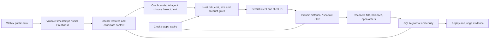

# معماری پیشنهادی و دفتر تصمیم‌ها

وضعیت: **T02 قراردادها/collector عمومی ساخته شد؛ کیفیت جامع داده و دسترسی خصوصی تأییدنشده‌اند. موتور هنوز پیاده‌سازی نشده است.** برچسب R/S/D/U طبق docs/challenge-brief.md. بخش‌های بعدی قرارداد پیشنهادی‌اند؛ دستورهای موجود در AGENTS.md هستند.

## انتخاب ابزار با دلیل

| گزینه | مزیت برای این چالش | هزینه/محدودیت | تصمیم |
|---|---|---|---|
| Python 3.12 + asyncio + Decimal + sqlite3 + logging | داده/تست و I/O با یک زبان؛ پول و وضعیت در کد قابل بررسی | سرویس و restart باید درست طراحی شود | D01: انتخاب پایه؛ محیط موجود همین خانواده است |
| Pydantic AI slim + OpenAI-compatible BoxAPI | خروجی typed، tool scope و usage limits با Chat Completions | schema جای risk نیست؛ قیمت واسطه باید جدا بررسی شود | D02 به‌روز: extra openai و gpt-6-luna؛ Google حذف، smoke و چهار سناریوی واقعی PASS |
| SDK مستقیم OpenAI + Pydantic روی BoxAPI | کنترل کمترواسطه برای یک فراخوانی ساختاریافته | tool loop و ثبت/بودجه را باید خودمان نگه داریم | فقط در صورت مشکل اندازه‌گیری‌شده framework؛ فعلاً همان Agent موجود مصرف می‌شود |
| LangGraph | مدیریت گردش حالت و persistence برای graph پیچیده | state machine سفارش به‌هرحال لازم است؛ graph اضافی فعلاً منفعت اثبات‌شده ندارد | فعلاً انتخاب نشد؛ با نیاز واقعی به workflow چندمرحله‌ای بازبینی شود |
| Bull/Bear چندایجنتی، AutoGen/CrewAI | فرضیه کاهش خطای تحلیل از چند دیدگاه | درخواست/تأخیر و عدم قطعیت بیشتر؛ شواهد مزیت برای این بازار نداریم | فعلاً حذف؛ فقط با ablation بهتر روی همان داده/بودجه اضافه شود |
| Wallex REST مستقیم با httpx | مرز روشن سفارش، حساب و reconciliation؛ قرارداد مستند | نگهداری adapter کوچک بر عهده ما | D03: مسیر اجرا؛ MCP الزام رسمی گزارش نشده |
| Wallex MCP | ابزار استاندارد برای Agent | S: endpoint ارسالی api.wallex.ir/mcp؛ initialize/tools/list و یک فراخوان عمومی موفق؛ ۵۲ ابزار شامل عملیات مالی | D: پنج ابزار عمومی در Codex فعال؛ موتور REST؛ بهبود کیفیت U؛ [شاهد](docs/wallex-mcp.md) |
| Centrifugo Python SDK | اتصال v2 و reconnect؛ بهتر از ساخت دستی پروتکل | gap کانال با reconnect حل نمی‌شود؛ dependency فقط وقت نیاز | T09 پس از proof REST اضافه شود؛ polling پرتعداد depth نکنید |
| pandas/NumPy یا ابزار بک‌تست موجود | پردازش/تحلیل تاریخی | نیازهای execution خاص والکس و نشت زمانی باید کنترل شود | فعلاً اضافه نشده؛ T07 کمترین ابزار مناسب را بعد از دیدن داده انتخاب کند |
| SQLite محلی و گزارش فایل | تک‌فرایند، پایدار، قابل تحویل و بدون سرویس اضافه | نیازمند دیسک پایدار و single writer | D04؛ Postgres/Redis/Prisma/Drizzle فعلاً توجیه ندارند |

منابع: [Pydantic AI testing](https://ai.pydantic.dev/testing/)، [خروجی typed](https://ai.pydantic.dev/output/)، [حدود usage](https://ai.pydantic.dev/agents/)، [OpenAI-compatible provider](https://ai.pydantic.dev/models/openai/)، [LangGraph](https://docs.langchain.com/oss/python/langgraph/overview). انتخاب از روی قابلیت‌ها و تناسب بریف است؛ ادعای بهتر بودن مدل در معامله نیست. حدود framework جای deadline، retry transport و بودجه تجمعی کل سرویس را نمی‌گیرد.

## نقد Blueprint و فرضیه‌هایی که پذیرفته نشدند

- ادعای برتری Bull/Bear یا latency دو تا سه ثانیه بدون benchmark همان provider/شبکه/ورودی قابل اتکا نیست. یک راند مناظره هم چند درخواست مدل دارد؛ تنها ablation هم‌هزینه می‌تواند ارزش آن را نشان دهد.
- پنج معامله برای کالیبره کردن احتمال برد و افزایش مرحله‌ای exposure شاهد کافی نیست؛ confidence مدل هم احتمال برد تجربی نیست. اعداد ۱۰ تا ۵۰ درصد حجم، ۸۰ درصد exposure و ۳٫۵ درصد قطع روزانه به عنوان policy مصوب پذیرفته نشده‌اند.
- کد نمونه حداقل Half-Kelly مثبت تحمیل می‌کند، شمارنده را هنگام محاسبه حجم بالا می‌برد و نه fill؛ ذخیره نقدینگی و توقف دوساعته/فروش اضطراری توضیح‌داده‌شده را اعمال نمی‌کند. drawdown آن نسبت به سرمایه اولیه است، نه peak یا پنجره روزانه.
- برچسب Production-Ready بدون validation دامنه، success=false، مدیریت UNKNOWN، reconciliation و persistence قابل دفاع نیست. نمونه را به موتور واقعی کپی نکنید.
- تغییر جهت USDT/TMN بدون دو پایه هم‌زمان و سود قفل‌شده، صرف نام «آربیتراژ» نیست؛ ریسک جهت قیمت دارد. استراتژی‌های orderbook نیز بدون داده عمق تاریخی، بک‌تست معتبر همان منطق ندارند.
- تایپ‌سیف بودن JSON خطای سفارش را صفر نمی‌کند. Decimal/precision، account، allowlist، fee و state باید جدا آزموده شوند. تمام ادعاهای استخراج‌شده از مخازن خارجی در Blueprint همچنان فرضیه‌اند؛ تحلیل کامل آن مخازن در این آماده‌سازی ادعا نشده است.

## مدل و آزمایش مقایسه‌ای

به درخواست تازه پوریا، BoxAPI کاملاً جای Gemini را در runtime گرفت: BOXAPI_API_KEY و LLM_BASE_URL=https://ai.boxapi.ir/ai/v1، فقط Chat Completions، مدل gpt-6-luna. انتخاب بر اساس تعرفه BoxAPI، نه قیمت مستقیم OpenAI است؛ docs/boxapi-budget.md مقایسه و سناریوی سه‌روزه را دارد. Google provider/dependency/key فعال حذف شد؛ شواهد تاریخی Gemini حفظ می‌شوند. تغییر مدل بدون smoke و مجموعه ثابت مجاز نیست و قوی‌تر بودن مدل، سود یا دقت بالاتر را تضمین نمی‌کند.

تست FunctionModel فقط سیم‌کشی قرارداد و توقف روی خطا را نشان می‌دهد. مقایسه واقعی: ورودی عددی و snapshot یکسان، سیاست ریسک ثابت، بودجه درخواست برابر؛ نرخ پاسخ معتبر، خطای دامنه، ابزارخوانی صحیح، تصمیم در شرایط بدون فرصت، زمان و token usage ثبت شود. سپس AI-on در برابر baseline بدون AI روی همان مسیر execution ارزیابی شود. latency کمتر به‌تنهایی معیار انتخاب نیست؛ خطای تصمیم هم سنجیده شود. سقف و تعرفه رزرو اکنون در config/llm-budget-policy.json نسخه‌دار است؛ invoice/balance واقعی و تعرفه آینده تأیید نشده‌اند. در مسیر فعلی Luna/Chat Completions با function calling، reasoning_effort=none حفظ شود؛ طبق [مستند رسمی مدل](https://developers.openai.com/api/docs/models/gpt-6-luna)، تغییر reasoning نیازمند بررسی سازگاری API است، نه فقط مقایسه سرعت. رعایت پارامتر ارسالی به BoxAPI در تست transport کنترل می‌شود؛ رفتار داخلی واسطه از این تست نتیجه نمی‌شود.

## بازار و نوع معامله

به‌روزرسانی پوریا: **فقط Spot بدون لوریج**؛ margin/borrow/short در دامنه چالش نیست. SELL خروج از موجودی واقعی است، نه باز کردن موقعیت فروش بدون دارایی. [قرارداد بازار](docs/market-access-policy.md) و snapshot قابل‌خواندن کد در `config/wallex-credit-market-policy.json` برای T02/T05/T06 لازم‌اند. universe اجرایی = بازارهای فعال و شناخته‌شده اسپات حساب پس از حذف تمام محدودیت‌ها؛ env فقط زیرمجموعه آن را انتخاب می‌کند. PAXG هر دو quote و دارایی‌های tokenized موجود در denylist انتخاب نشوند. تصویر نبود قابلیت «بات معامله‌گر» داخلی را نشان می‌دهد، نه منع موتور خارجی API؛ دسترسی حساب اختصاصی بعداً آزموده می‌شود.

## جریان و مرزها

مدل حساب و Secret را نمی‌بیند. ابزارهای احتمالی آن فقط `get_recent_candles`، `get_market_snapshot` و `get_position_summary` با شناسه/بازه معتبر و allowlist هستند. داده دریافت‌شده دستور سیستم نیست. LLM درخواست یا پیشنهاد می‌دهد؛ ریسک/حسابداری/سفارش میزبان قطعی‌اند. مدل از shell، فایل‌های .env، URL دلخواه، انتقال دارایی و اجرای سفارش خام دسترسی ندارد.

استراتژی نامزد: انتخاب موقعیت/عدم اقدام توسط AI از زمینه عددی محدود (روند، نوسان، حجم، هزینه، نقدینگی، موقعیت فعلی). شروع پژوهش با دو فرضیه ساده «ادامه مومنتوم» و «بازگشت به میانگین در بازار خنثی»؛ این‌ها برنده تأییدشده نیستند. تنها نامزد با شواهد قابل دفاع توسعه یابد. scalping مبتنی بر orderbook تاریخی بدون داده عمق قابل replay ادعا نشود. قیمت طلا/نقره یا هر دارایی از حرف کاربر، مجاز بودن بازار را ثابت نمی‌کند.

**D05:** تصمیم AI روی رویداد لازم/کندل بسته اجرا می‌شود؛ پایش ریسک و وضعیت سفارش مستقل است. stop، stale-data gate و پایان زمان نباید منتظر جواب LLM بمانند. سقف فعلی مسیر probe دو turn، یک ابزار خواندنی، صفر retry/repair، ۵۱۲ output token و deadline سی ثانیه است؛ سقف پول/مصرف تجمعی را ModelBudget پیش از HTTP اعمال می‌کند. این اعداد قرارداد داخلی جاری‌اند، نه قانون مسابقه؛ افزایش خودکار یا fallback برای تکمیل چرخه مجاز نیست.

## ساختار فعلی و ساختار موردنیاز هنگام پیاده‌سازی

اکنون: مستندات، probeها، tests و شواهد عمومی؛ `src/royin/config.py` و `__main__.py` مصرف‌کننده واقعی T01 هستند. CLI فقط config را بررسی می‌کند، transport ندارد و همه liveها را رد می‌کند. هیچ فایل خالی برای بخش‌های بعدی ساخته نشده است.

ساختار `src/royin/` فقط با مصرف‌کننده واقعی گسترش یابد:

| بخش پیشنهادی | مسئولیت |
|---|---|
| config.py / models.py | .env و policy معتبر، enum و Decimal؛ مقادیر خالی live را متوقف کنند |
| market_data.py | آداپتر REST/بعداً socket، snapshot، timezone و freshness |
| strategy.py / agent.py | feature گذشته و تصمیم AI؛ prompt/ابزار/مدل/version مشخص |
| risk.py | سقف exposure و سفارش، حد ضرر، هزینه، ریسک عدم امکان خروج |
| broker.py / wallex.py | تفکیک حالت‌ها؛ intent، client_id، ثبت/لغو/استعلام واقعی |
| ledger.py | وضعیت تراکنشی سفارش، fill و fee و equity و manifest |
| evaluation.py | replay، walk-forward، معیارها و export |
| __main__.py | CLI واقعی پس از ساخت؛ اکنون دستور ربات وجود ندارد |

فایل‌ها می‌توانند در نسخه کوچک ادغام شوند؛ جدول الزام به ساخت همه فایل‌ها نیست. tests کنار قراردادهای مصرف‌شده، fixtures فقط قرارداد مستند/پاسخ sanitized. data و artifacts محلی ignored؛ نسخه sanitized لازم داوری با انتخاب صریح به docs/evidence منتقل شود.

## قرارداد داده پیشنهادی

- `MarketSnapshot`: symbol، base/quote، زمان event و received UTC، آخرین کندل بسته، bids/asks در صورت وجود، min-notional/step/precision/status با منبع و زمان.
- `Decision`: run_id/decision_id، snapshot hash، زمان cutoff، action=WAIT/ENTER/EXIT، symbol، candidate/evidence IDs، دلیل کوتاه قابل نمایش و invalidation؛ پیشنهاد مدل هنوز سفارش نیست. متن دلیل خلاصه شواهد است، نه درخواست زنجیره فکر خصوصی.
- `RiskResult`: approved/reason، quantity/price پس از quantization، fee و هزینه بدبینانه، exposure قبل/بعد، stop/زمان خروج و policy version. اعتماد مدل احتمال برد کالیبره نیست و ورودی Kelly نمی‌شود.
- `OrderIntent`: persisted unique client_id، تصمیم مرتبط، حساب مستعار، سمت/نوع/مقدار، payload hash و وضعیت ارسال. پاسخ ۲۰۱ پذیرش است، fill نیست.
- `Order/Fill`: شناسه صرافی/کلاینت، وضعیت و cumulative filled quantity، هر fill و feeAsset با کلید dedup؛ لغو، پر شدن جزئی و مسابقه cancel/fill ثبت شوند.
- `EquityPoint`: موجودی آزاد/قفل، valuation و روش قیمت‌گذاری، net TMN، realized P&L و drawdown؛ ارزش کل و realized یکی نیستند.
- `RunManifest`: git revision و clean state، config/prompt/policy hash بدون secrets، model/provider/version، زمان، داده/hash، mode و dependency lock. مدل ممکن است alias باشد؛ metadata نسخه واقعی اگر provider داد ثبت شود.

## مسیرهای Wallex و قرارداد خطا

| نیاز | مسیر مستند عمومی | نکته |
|---|---|---|
| کندل | GET /v1/udf/history | آرایه‌های t/o/h/l/c/v؛ validation و بازه دقیق |
| depth | GET /v1/depth?symbol=... | bid/ask؛ polling پرتکرار نکنید |
| قوانین بازار | GET /hector/web/v1/markets | در پاسخ واقعی result.markets دیده شد؛ فرض symbols نکنید؛ schema T02 |
| fee | GET /v1/account/fee | قبل از live برای حساب هکاتون تأیید شود |
| credit balance | GET /v1/account/balances-detail | schema رسمی اعتبار: result[asset].total/available/freeze؛ هدر حساب اختصاصی اجباری؛ authenticated هنوز آزموده نشده |
| ایجاد | POST /v1/account/orders | quantity و price رشته، stop_Price شرطی، client_id پایدار |
| استعلام | GET /v1/account/orders/{client_id} | timeout ارسال را پیش از هر retry با این/فهرست تطبیق دهید |
| لغو | DELETE /v1/account/orders/{client_id} | body قدیمی Blueprint مبنا نیست؛ cancel با fill هم‌زمان reconcile شود |

مسیر سایر endpointها، از جمله open orders، از مستند واقعی خوانده و با پاسخ حساب تأیید شود. Web API داخلی محصول لازم نیست؛ مسیر ساختگی `/api/trade` نسازید.

**تصحیح T02 / S:** `/v1/account/balances` در مستند کیف‌پول حساب اصلی است؛ یادداشت قبلی آن را برای حساب اعتباری تأیید نکرده بود و اکنون superseded است. Swagger رسمی اعتبار مسیر balances-detail و هدر sub-account-client-id را نشان می‌دهد؛ با وجود عبارت متناقض «no custom header» در description، پارامتر ساخت‌یافته و اصل fail-closed مبناست. هیچ درخواست خصوصی در T02 ارسال نشد. fixture موجودی/fee فقط schema با عدد synthetic است؛ min-order، معنای precision به‌عنوان tick/step، هویت حساب و تازگی محدودیت‌ها هنوز نیازمند تأیید واقعی‌اند.

برای درخواست خصوصی: origin رسمی allowlist، TLS فعال، redirect غیرفعال، هدر x-api-key و sub-account-client-id هر دو اجباری؛ نبود شناسه اعتبار fallback به حساب اصلی نداشته باشد. schema و success و وضعیت HTTP هر سه بررسی شوند. 401/403 خطای تنظیم، 429 توقف محدود با Retry-After، 5xx/read timeout فقط خواندن با backoff محدود؛ timeout نوشتن حالت **UNKNOWN** است، نه شکست قطعی. SDK/adapter تنها یک مالک retry دارد و تعداد همه تلاش‌ها حساب می‌شود.

ماشین حالت پیشنهادی: INTENT → SUBMITTING → ACK/UNKNOWN → OPEN/PARTIAL → FILLED/CANCELED/REJECTED؛ نام status صرافی را از API واقعی map کنید، نه از این نام‌های داخلی حدس بزنید. پیش از restart/شروع مجدد، UNKNOWNها، سفارش باز و موجودی تطبیق داده شوند. در ابهام، exposure جدید متوقف شود؛ سفارش با شناسه تازه تکرار نشود. یک worker/قفل حساب لازم است؛ اجرای هم‌زمان روی لپ‌تاپ و سرور ممنوع.

## ریسک، پایان و پایداری

سیاست نسخه‌دار شامل سقف سفارش، سقف exposure، ریسک هر معامله، stop، kill threshold و حاشیه liquidation است؛ هیچ مقدار Blueprint بی‌دلیل رسمی تلقی نشود. شروع واقعی طبق درخواست پوریا در حداقل مقدار **قابل خروج** بازار باشد: min notional، گام quantity، fee در کوین، حداقل فروش و تغییر قیمت لحاظ شوند. اگر حداقل بازار بیش از سقف سیاست است، معامله نکنید. sizing بر اساس ریسک و محدودیت باشد؛ برای هر نمره مدل حداقل خرید مثبت تحمیل نکنید.

متریک drawdown داخلی: `max((peak_equity - equity) / peak_equity)` روی equity خالص لحظه‌ای؛ درصد کاهش از سرمایه اولیه جدا گزارش شود چون فرمول داوری معلوم نیست. stop exchange-side پس از اثبات پشتیبانی ارجح است؛ stop-limit تضمین fill نیست. از مسدود شدن یک دارایی با stop و سفارش خروج هم‌زمان جلوگیری شود. فقدان stop معتبر/اطلاعات تازه ورود جدید را می‌بندد، اما مدیریت موقعیت موجود باید با مسیر مستقل ادامه یابد.

پایان به وقت ایران ۲۰۲۶-۱۰-۲۳ ساعت ۲۳:۵۰، بنا به پاسخ پوریا تأیید شده است. config با offset ذخیره و UTC پردازش شود. برنامه پیش از مهلت ورود را می‌بندد، سفارش‌های ورود را لغو/تطبیق می‌دهد و با سیاست هزینه/مهلت دارایی‌ها را به TMN برمی‌گرداند؛ برای USDT و dust سؤال باز است. finalization باید idempotent، قابل resume و با خطای صریح residual باشد. توقف ایمن هرگز عبارت «همه فروخته شد» بدون تأیید fill تولید نکند.

SQLite روی دیسک پایدار؛ intent پیش از side effect و fill و مصرف آن در تراکنش. failure نوشتن journal، ورود را متوقف کند. schema version و migration افزایشی با backup و تست upgrade؛ تاریخچه migration اجراشده هرگز دستی تغییر نکند. اگر ORM بعداً اضافه شد، فقط workflow واقعی همان ابزار مستند شود.

## محل اجرا

**D06:** توسعه و replay روی لپ‌تاپ؛ worker روی لیارا اگر probe شبکه والکس و BoxAPI، timezone/NTP، دیسک پایدار، restart، log export و یک نمونه فعال تأیید شد. مستندات رسمی [disk](https://docs.liara.ir/paas/python/how-tos/use-disk/) و [supervisord](https://docs.liara.ir/paas/python/how-tos/use-supervisord/) بررسی شدند؛ deployment هنوز انجام نشده است. برای loop مداوم cron نسازید. Secrets از تنظیمات میزبان، SQLite/manifest روی volume، health شامل age داده/آخرین چرخه و خطا؛ موفقیت deploy برابر readiness نیست.

اگر زمان راه‌اندازی/محدودیت شبکه سرور حل نشد، لپ‌تاپ برق‌دار، Sleep/Hibernate خاموش، اینترنت آزموده و supervisor/بازیابی معتبر می‌تواند موقتاً worker یگانه باشد؛ این محدودیت پایداری در شواهد ذکر شود. انتقال مالکیت اجرا فقط پس از توقف worker قبلی و reconcile حساب انجام شود.
