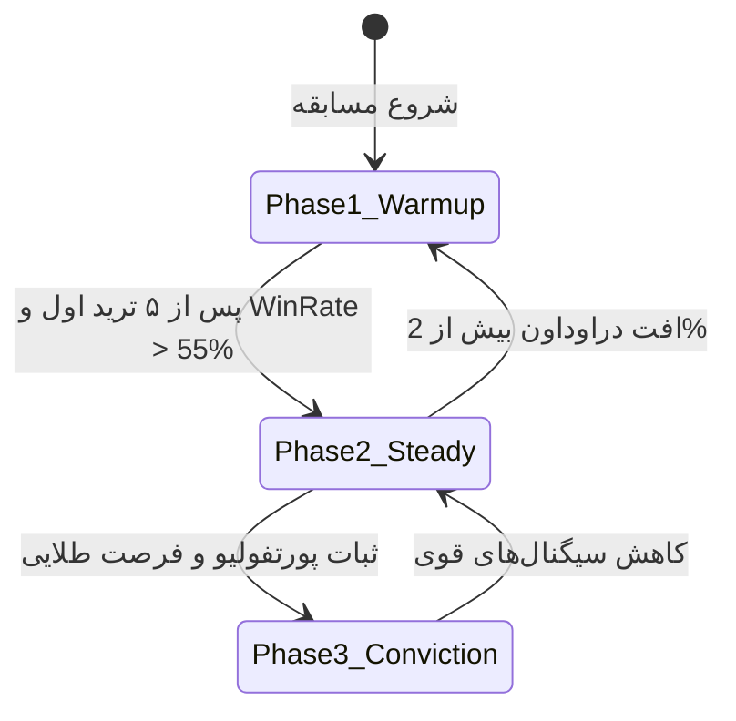
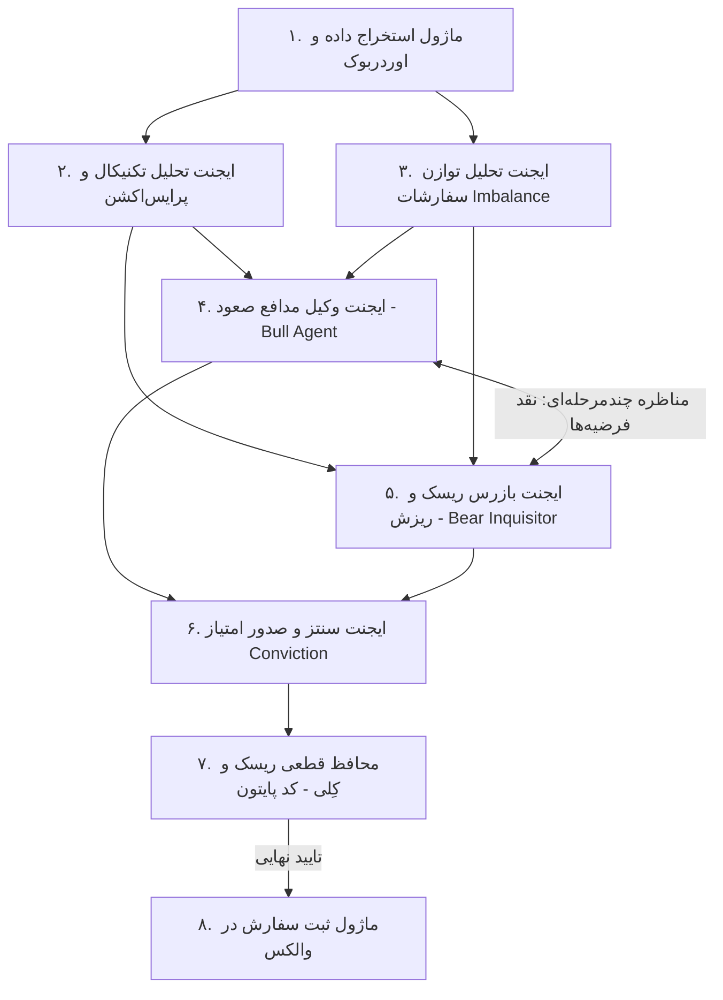

> **وضعیت مرجع قدیمی، ۲۰۲۶-۱۰-۲۱:** این سند فرضیه پژوهشی است و کد آماده معامله یا قواعد مسابقه نیست. برای شروع [AGENTS.md](AGENTS.md)، [قرارداد واقعی چالش](docs/challenge-brief.md) و [معماری فعلی](ARCHITECTURE.md) را بخوانید. مشخصات API، درصدهای ریسک و ادعاهای عملکرد زیر باید جداگانه تأیید شوند.

# سند جامع معماری، اکتشافات فنی و پیاده‌سازی ربات تریدر هوشمند والکس
## Wallex AI Autonomous Trading Agent — Master Architecture & Tournament Blueprint

> **هدف سند:** این سند به عنوان یک راهنمای جامع مهندسی (Master Blueprint) برای هر ایجنت هوش مصنوعی، توسعه‌دهنده یا تیم فنی تدوین شده است تا با مطالعه آن، بدون نیاز به آزمون و خطای مجدد، پیشرفته‌ترین، کم‌ریسک‌ترین و سودآورترین ربات معاملاتی الگوریتمی را بر بستر صرافی **والکس (Wallex API)** پیاده‌سازی نماید.

---

## فهرست سرفصل‌ها
1. [تحلیل جامع مخازن برتر هوش مصنوعی معاملاتی در دنیا و یافته‌های استخراج‌شده](#۱-تحلیل-جامع-مخازن-برتر-هوش-مصنوعی-معاملاتی-در-دنیا-و-یافته‌های-استخراج‌شده)
2. [مشخصات کامل و موشکافانه API صرافی والکس (Wallex API Specs)](#۲-مشخصات-کامل-و-موشکافانه-api-صرافی-والکس)
3. [استراتژی تخصیص سرمایه داینامیک و فازبندی ریسک (Capital Allocation & Sizing)](#۳-استراتژی-تخصیص-سرمایه-داینامیک-و-فازبندی-ریسک)
4. [فرمول‌های ریاضی و محافظ‌های قطعی ریسک (Mathematical Risk Guards)](#۴-فرمولهای-ریاضی-و-محافظهای-قطعی-ریسک)
5. [معماری چندایجنتی مناظره‌محور (Multi-Agent Bull/Bear Debate Engine)](#۵-معماری-چندایجنتی-مناظره‌محور)
6. [استراتژی‌های معاملاتی اختصاصی بازار والکس (Trading Strategies)](#۶-استراتژیهای-معاملاتی-اختصاصی-بازار-والکس)
7. [پیاده‌سازی مرجع و کدهای پایه‌ای پایتون (Production-Ready Python Boilerplate)](#۷-پیاده‌سازی-مرجع-و-کدهای-پایه‌ای-پایتون)
8. [چک‌لیست عملیاتی استارت مسابقه (Tournament Checklist)](#۸-چک‌لیست-عملیاتی-استارت-مسابقه)

---

## ۱. تحلیل جامع مخازن برتر هوش مصنوعی معاملاتی در دنیا و یافته‌های استخراج‌شده

> [!NOTE]
> **یادداشت تحلیلی و سلب قطعیت مهندسی:**
> تحلیل‌ها، نکات و یافته‌های ارائه شده در این بخش، حاصل ارزیابی موشکافانه کدها، معماری‌های اجراشده و مستندات فنی این مخازن در شرایط آزمایشی است. این یافته‌ها نباید به عنوان **«حقیقت مطلق یا تضمین‌شده»** تلقی شوند، زیرا پویایی بازار رمزارزها، تغییرات در تأخیر شبکه و رفتار غیرقطعی مدل‌های زبانی (LLMs) ممکن است نتایج متفاوتی رقم بزنند. ایجنت‌های توسعه‌دهنده باید این مشاهدات را به عنوان فرضیات راهنما مد نظر قرار داده و با شرایط لحظه‌ای مسابقه کالیبره کنند.

---

### ۱.۱. [TauricResearch / TradingAgents](https://github.com/TauricResearch/TradingAgents)
* **لینک مخزن گیت‌هاب:** [https://github.com/TauricResearch/TradingAgents](https://github.com/TauricResearch/TradingAgents)
* **مقاله رسمی آکادمیک:** [TradingAgents: Multi-Agent LLM Financial Trading Framework (arXiv)](https://arxiv.org/abs/2412.20132)
* **معماری و نحوه کارکرد:**
  این فریم‌ورک ساختار یک شرکت معاملات الگوریتمی (Prop Firm) را شبیه‌سازی می‌کند. در این ساختار، تحلیل‌گران اولیه (تکنیکال، فاندامنتال، سنتیمنت و اخبار) خروجی‌های خود را مستقیماً به تریدر نمی‌دهند؛ بلکه خروجی به یک **تیم پژوهشی شامل دو ایجنت متخاصم (Bull Researcher و Bear Researcher)** تحویل داده می‌شود. این دو ایجنت وارد چند دور مناظره ساختاریافته (Structured Debate) می‌شوند تا سوگیری تایید (Confirmation Bias) مدل از بین برود. در نهایت، ایجنت تریدر و مدیر ریسک تصمیم را نهایی می‌کنند.

#### تحلیل ریپازیتوری و یافته‌های استخراج‌شده (Analytical Insights):
* **نقطه قوت کلیدی:** الگوی مناظره Bull/Bear موثرترین راه‌حل تاکنون برای خنثی کردن «توهم خرید زودهنگام» در مدل‌های زبانی است. در این بررسی مشاهده شد که مدل‌ها در حالت تک‌پرامپت تمایل دارند با دیدن کوچک‌ترین نشانه مثبت فوراً سیگنال خرید صادر کنند، اما وجود ایجنت بازرس نزولی (Bear) مانع از ورود در دام‌های صعودی (Bull Traps) می‌شود.
* **ریسک و نقطه ضعف احتمالی:** هزینه بالای زمان پردازش (Latency) و مصرف توکن؛ در صورتی که تعداد راندهای مناظره نامحدود باشد، ممکن است صدور تصمیم بین ۱۵ تا ۳۰ ثانیه طول بکشد که در نوسانات سریع بازار کریپتو کشنده است.
* **توصیه اجرایی برای ایجنت:** مناظره را دقیقاً به **یک راند تک‌مرحله‌ای و ساختاریافته (Single-Round Structured Debate)** با خروجی JSON محدود کنید تا زمان تصمیم‌گیری زیر ۲ تا ۳ ثانیه باقی بماند.

---

### ۱.۲. [virattt / ai-hedge-fund](https://github.com/virattt/ai-hedge-fund)
* **لینک مخزن گیت‌هاب:** [https://github.com/virattt/ai-hedge-fund](https://github.com/virattt/ai-hedge-fund)
* **مستندات معماری:** [https://aihedgefund.substack.com](https://aihedgefund.substack.com)
* **معماری و نحوه کارکرد:**
  بزرگ‌ترین پروژه منبع‌باز شبیه‌ساز صندوق پوشش ریسک (با بیش از ۱۲ هزار ستاره). سیستم از دو لایه تشکیل شده است:
  1. **Discretionary Pods:** ایجنت‌هایی با پرسونای معامله‌گران مشهور (وارن بافت برای ارزش‌سنجی، مایکل بری برای سناریوهای نزولی و بحران، کتی وود برای رشد تکنولوژی).
  2. **Systematic Pods:** کدهای الگوریتمی قطعی برای تست‌های آماری و حجم‌سنجی.

#### تحلیل ریپازیتوری و یافته‌های استخراج‌شده (Analytical Insights):
* **نقطه قوت کلیدی:** تفکیک هوشمندانه لایه نظرات کیفی از لایه محاسبات مالی. این ریپازیتوری نشان می‌دهد که هوش مصنوعی صرفاً باید **امتیاز اطمینان (Conviction Score بین -1.0 تا +1.0)** بدهد و تعیین حجم معامله (Position Sizing) باید ۱۰۰٪ در کدهای سنتی ریاضی و قوانین ریسک انجام شود.
* **ریسک و چالش پنهان:** پرسوناهای ارزشی کلاسیک (مانند وارن بافت یا بنجامین گراهام) در بازارهای کریپتو و بازه‌های زمانی کوتاه (اسکالپ/روزانه) اغلب کارایی ضعیفی دارند؛ زیرا آن‌ها منتظر ارزش ذاتی می‌مانند و نوسانات سریع پرایس‌اکشن را از دست می‌دهند.
* **توصیه اجرایی برای ایجنت:** برای مسابقه والکس، پرسوناهای سنگین فاندامنتال را با پرسوناهای تکنیکالی/نوسانی (مانند پرسونای مومنتوم، پرسونای ضد روند/Mean-Reversion و پرسونای محافظ سرمایه) جایگزین کنید.

---

### ۱.۳. [AI4Finance-Foundation / FinRobot](https://github.com/AI4Finance-Foundation/FinRobot) (و پروژه‌های FinGPT / FinRL)
* **لینک مخزن FinRobot:** [https://github.com/AI4Finance-Foundation/FinRobot](https://github.com/AI4Finance-Foundation/FinRobot)
* **لینک مقاله رسمی FinRobot:** [FinRobot: An Open-Source AI Agent Platform for Financial Applications (arXiv)](https://arxiv.org/abs/2405.14767)
* **لینک بنیاد AI4Finance:** [https://github.com/AI4Finance-Foundation](https://github.com/AI4Finance-Foundation)
* **معماری و نحوه کارکرد:**
  ابداع الگوی **Financial Chain-of-Thought (Financial CoT)** در سه گام:
  * `Data-CoT`: دریافت و نرمال‌سازی دیتا از منابع مختلف و اوردربوک.
  * `Concept-CoT`: نگاشت وضعیت فعلی به الگوهای تکنیکال کلاسیک و پرایس‌اکشن.
  * `Thesis-CoT`: صدور گزارش استراتژی همراه با تارگت و استاپ لاس.
  نسخه‌های جدید FinRobot از فریم‌ورک‌های مدرنی مثل **PydanticAI** و **DeepSeek Harness** جهت تایپ‌سیف بودن داده‌ها استفاده می‌کنند.

#### تحلیل ریپازیتوری و یافته‌های استخراج‌شده (Analytical Insights):
* **نقطه قوت کلیدی:** استفاده از PydanticAI و اعتبارسنجی تایپ‌ها (Type Safety) باعث می‌شود پاسخ‌های مدل در قالب مدل‌های داده‌ای строго تعریف شوند و خطای پارس JSON یا کرش در ارسال سفارشات به صفر برسد.
* **محدودیت شناسایی‌شده:** معماری این ریپازیتوری بیشتر برای تحلیل سهام سنتی و گزارش‌های مالی ۱۰-K شرکت‌های بورسی آمریکا توسعه یافته است تا تحلیل عمق اردرهای کریپتو.
* **توصیه اجرایی برای ایجنت:** گام `Concept-CoT` در این پروژه را باید دقیقاً با مفاهیم میکرواستراکچر رمزارز (مثل Orderbook Imbalance، حجم معاملات وب‌سوکت و واگرایی‌های RSI) سفارشی‌سازی کنید.

---

### ۱.۴. [LLMQuant / awesome-trading-agents](https://github.com/LLMQuant/awesome-trading-agents)
* **لینک مخزن گیت‌هاب:** [https://github.com/LLMQuant/awesome-trading-agents](https://github.com/LLMQuant/awesome-trading-agents)
* **اهمیت مخزن:**
  مرجع جامع و به‌روز تمامی ابزارها، اسکیل‌ها، اکستنشن‌های MCP و فریم‌ورک‌های ایجنتی معامله‌گری.

#### تحلیل ریپازیتوری و یافته‌های استخراج‌شده (Analytical Insights):
* **نکته کلیدی استخراج‌شده:** این مرجع نشان می‌دهد موفق‌ترین تریدرهای هوش مصنوعی کسانی هستند که ابزارهای محیطی را از طریق **MCP یا تول‌های استاندارد سبک** به مدل متصل کرده‌اند نه اینکه تلاش کنند تمام وضعیت بازار را در قالب پرامپت‌های بسیار طولانی وارد کانتکست مدل کنند.
* **ریسک پرامپت‌های شلوغ:** اضافه کردن بیش از اندازه ابزارها و دیتاهای غیرمرتبط باعث سردرگمی مدل و افت دقت در انتخاب ابزار (Tool Misdirection) می‌شود.

---

### ۱.۵. [tradermonty / claude-trading-skills](https://github.com/tradermonty/claude-trading-skills)
* **لینک مخزن گیت‌هاب:** [https://github.com/tradermonty/claude-trading-skills](https://github.com/tradermonty/claude-trading-skills)
* **مستندات آنلاین:** [https://tradermonty.github.io/claude-trading-skills/](https://tradermonty.github.io/claude-trading-skills/)
* **معماری و نحوه کارکرد:**
  مجموعه اسکیل‌های پیشرفته برای Claude Code و Cursor جهت بررسی چارت، اسکرینینگ سهام با فیلترهای CANSLIM و فین‌ویز، چک‌لیست مدیریت ریسک پوزیشن، و آمادگی قبل از بازگشایی بازار (Pre-market Routine).

#### تحلیل ریپازیتوری و یافته‌های استخراج‌شده (Analytical Insights):
* **نقطه قوت کلیدی:** ساختاردهی چک‌لیست‌های پیش از ورود (Pre-Trade Checklist). پیش از ورود به هر پوزیشن، ایجنت باید ۵ سوال سخت درباره روند کلی، ریسک رویدادهای پیش رو، نسبت R:R و حجم نقدینگی را پاسخ دهد.
* **توصیه اجرایی برای ایجنت:** چک‌لیست این مخزن را باید به عنوان یک «گیت اجباری» قبل از فراخوانی تابع ثبت سفارش در کدهای پایتون قرار دهید.

---

### ۱.۶. [hummingbot / hummingbot](https://github.com/hummingbot/hummingbot) و [freqtrade / freqtrade](https://github.com/freqtrade/freqtrade)
* **لینک Hummingbot:** [https://github.com/hummingbot/hummingbot](https://github.com/hummingbot/hummingbot)
* **لینک Freqtrade:** [https://github.com/freqtrade/freqtrade](https://github.com/freqtrade/freqtrade)

#### تحلیل ریپازیتوری و یافته‌های استخراج‌شده (Analytical Insights):
* **درس‌آموخته هامینگ‌بات (میکرواستراکچر و اسلیپیج):** در صرافی‌های متمرکز کریپتو (به‌ویژه جفت‌ارزهای با عمق کمتر در بازارهای محلی)، ثبت سفارشات مارکت بزرگ ممکن است قیمت را جابجا کند و اسلیپیج سنگینی تحمیل کند. هامینگ‌بات سفارشات را خرد می‌کند (Order Slicing) یا از سفارشات لیمیت نزدیک به Best Bid/Ask استفاده می‌کند.
* **درس‌آموخته فریک‌ترید (مدیریت خطای Overfitting):** استراتژی‌هایی که در گذشته سوددهی ۱۰۰٪ نشان می‌دهند در ۹۰٪ موارد در لایو مارکت سقوط می‌کنند؛ زیرا روی داده‌های گذشته اورفیت شده‌اند. کلید پیروزی، سادگی قوانین ورود، استاپ‌لاس بدون اغماض و کنترل حجم پویا است.

---

## ۲. مشخصات کامل و موشکافانه API صرافی والکس

* **مستندات رسمی توسعه‌دهندگان والکس:** [https://developers.wallex.ir/docs](https://developers.wallex.ir/docs)
* **دامنه پایه REST API:** `https://api.wallex.ir`
* **دامنه پایه وب‌سوکت v2 (سنتریفیگو):** `wss://api.wallex.ir/connection/websocket`

---

### ۲.۱. ساختار احراز هویت و تفاوت حیاتی حساب اصلی با «اعتبار معاملاتی»

> [!CAUTION]
> **نکته بسیار حیاتی برای شرکت در مسابقه:**
> اگر بودجه مسابقه در قالب **اعتبار معاملاتی (Trade Credit)** به شما داده شده است، طبق مستندات صرافی والکس:
> 1. این اکانت دارای **کیف‌پول مجزا** و **API-Key اختصاصی** است که باید در پنل والکس از بخش حساب اعتباری تولید شود.
> 2. علاوه بر هدر `x-api-key`، شما **باید حتماً** هدر `sub-account-client-id` را در تمام درخواست‌های اسپات ارسال کنید، در غیر این صورت معامله روی حساب اصلی ثبت می‌شود یا خطای دسترسی صادر می‌گردد:

```http
Content-Type: application/json
x-api-key: YOUR_WALLEX_API_KEY
sub-account-client-id: YOUR_SUBACCOUNT_CLIENT_ID
```

---

### ۲.۲. مرجع جامع اندپوینت‌های والکس (REST API)

#### ۱. دریافت موجودی کیف‌پول (Account Balances)
* **متد و مسیر:** `GET /v1/account/balances`
* **هدرها:** `x-api-key` (و `sub-account-client-id` برای حساب اعتباری)
* **نمونه پاسخ:**
```json
{
  "success": true,
  "result": {
    "balances": {
      "TMN": { "value": "5000000", "locked": "0" },
      "USDT": { "value": "120.50", "locked": "10.00" },
      "BTC": { "value": "0.002", "locked": "0" }
    }
  }
}
```

#### ۲. دریافت لیست بازارها و قوانین سفارش‌گذاری (Markets Metadata)
* **متد و مسیر:** `GET /hector/web/v1/markets`
* **توضیحات:** دریافت حداقل اندازه معامله (`min_order_value`)، گام قیمت، و وضعیت باز بودن بازار.

#### ۳. دریافت کندل‌های تاریخی چارت (Candles - UDF)
* **متد و مسیر:** `GET /v1/udf/history?symbol={symbol}&resolution={res}&from={from}&to={to}`
* **پارامترها:**
  * `symbol`: نماد بازار (مانند `BTCTMN` یا `USDTTMN`)
  * `resolution`: تایم‌فریم (مثلاً `1`, `5`, `15`, `60`, `D`)
  * `from` و `to`: تایم‌استمپ یونیکس به ثانیه
* **پاسخ:** آرایه‌های `t` (زمان)، `o` (Open)، `h` (High)، `l` (Low)، `c` (Close)، `v` (Volume).

#### ۴. دریافت عمق بازار و اوردربوک (Orderbook Depth)
* **متد و مسیر:** `GET /v1/depth?symbol={symbol}`
* **نمونه پاسخ:**
```json
{
  "result": {
    "ask": [
      { "price": "6210000000", "quantity": "0.05" },
      { "price": "6220000000", "quantity": "0.12" }
    ],
    "bid": [
      { "price": "6200000000", "quantity": "0.08" },
      { "price": "6190000000", "quantity": "0.25" }
    ]
  }
}
```

#### ۵. ثبت سفارش اسپات (Create Spot Order)
* **متد و مسیر:** `POST /v1/account/orders`
* **پارامترهای بدنه (JSON Payload):**
  * `client_id`: رشته یکتا تولیدشده توسط ربات برای ردیابی (الزامی برای لغو).
  * `symbol`: نماد جفت‌ارز (مثلاً `BTCTMN` یا `USDTTMN`).
  * `type`: یکی از مقادیر `LIMIT`, `MARKET`, `STOP_LIMIT`, `STOP_MARKET`.
  * `side`: یکی از مقادیر `BUY` یا `SELL`.
  * `price`: قیمت سفارش (رشته متنی، برای نوع لیمیت).
  * `quantity`: مقدار رمزارز (رشته متنی).
  * `stop_Price`: قیمت فعال‌ساز شرطی (دقت شود حرف `P` بزرگ است).

```json
{
  "client_id": "bot_order_101",
  "symbol": "USDTTMN",
  "type": "STOP_LIMIT",
  "side": "SELL",
  "price": "98500",
  "quantity": "50",
  "stop_Price": "99000"
}
```

#### ۶. لغو سفارش فعال (Cancel Order)
* **متد و مسیر:** `DELETE /v1/account/orders`
* **بدنه:**
```json
{
  "client_id": "bot_order_101"
}
```

#### ۷. دریافت سفارشات باز (Open Orders)
* **متد و مسیر:** `GET /v1/account/openOrders?market={symbol}`

---

### ۲.۳. مشخصات وب‌سوکت نسخه ۲ والکس (Centrifugo WebSocket v2)
* **آدرس اتصال:** `wss://api.wallex.ir/connection/websocket` (دقت شود اسلش پایانی وجود نداشته باشد).
* **پروتکل:** مبتنی بر Centrifugo. برای پایتون کتابخانه `centrifuge-python` پیشنهاد می‌شود.
* **کانال‌های عمومی پرکاربرد:**
  * `orderbook:<SYMBOL>@buyDepth` و `orderbook:<SYMBOL>@sellDepth`: عمق آنی خرید و فروش.
  * `public:<SYMBOL>@trade`: گزارش آخرین معاملات قطعی بازار.
  * `candle:<SYMBOL>@<INTERVAL>`: جریان داده کندل‌ها (مثلاً `candle:USDTTMN@1m`).
  * `public:all@price`: قیمت لحظه‌ای تمامی جفت‌ارزها.
* **مدیریت اتصال:**
  * سرور هر ۲۰ ثانیه پینگ استاندارد ارسال می‌کند؛ اگر تا ۳۰ ثانیه پاسخ پونگ دریافت نشود، سوکت ریست می‌شود.
  * با استفاده از کتابخانه Centrifugo، مدیریت پینگ/پونگ و اتصال مجدد به صورت کاملاً خودکار انجام می‌پذیرد.

---

## ۳. استراتژی تخصیص سرمایه داینامیک و فازبندی ریسک

یکی از شروط کلیدی موفقیت در مسابقه، **جلوگیری از افت شدید سرمایه در ساعات ابتدایی (Drawdown Protection)** است تا مدل کالیبره شود. بودجه به صورت ۳ فاز داینامیک مدیریت می‌شود:



| فاز | عنوان | درصد سرمایه در هر پوزیشن | استاپ‌لاس مجاز | هدف فاز |
| :--- | :--- | :---: | :---: | :--- |
| **فاز ۱** | **وارم‌آپ و کالیبراسیون** (۵ ترید اول) | **۱۰٪ الی ۱۵٪** | **۱.۵٪** | بررسی واقعی تاخیر وب‌سوکت، سنجش اسپرد والکس، هماهنگی بدون ریسک |
| **فاز ۲** | **رشد باثبات و سود مرکب** | **۲۰٪ الی ۳۵٪** | **۲٪ الی ۲.۵٪** | استفاده از فرمول Half-Kelly و ثبت معاملات با کیفیت عالی |
| **فاز ۳** | **فرصت‌های با اطمینان بسیار بالا** | **تا سقف ۵۰٪** | **۳٪ با تریلینگ** | ورود سنگین در شکست‌های حجمی یا واگرایی‌های پرقدرت |

> [!IMPORTANT]
> **قانون نقدینگی رزرو (Liquidity Buffer):**
> ربات در هیچ شرایطی اجازه ندارد بیش از **۸۰٪ کل دارایی** را وارد پوزیشن‌های باز کند. حداقل ۲۰٪ دارایی باید همیشه نقد (تومان یا تتر) بماند تا در صورت بروز ریزش‌های ناگهانی بازار، امکان خرید در کف (Buy the Dip) و جبران ضرر وجود داشته باشد.

---

## ۴. فرمول‌های ریاضی و محافظ‌های قطعی ریسک

این قوانین در قالب کدهای پایتونی قطعی در سطح سیستم اجرا شده و هوش مصنوعی اجازه تغییر یا دور زدن آن‌ها را ندارد:

### ۴.۱. فرمول محاسبه اندازه پوزیشن بر مبنای نیم‌کِلی (Half-Kelly Criterion)
معیار کِلی برای بهینه‌سازی نرخ رشد سرمایه استفاده می‌شود. جهت جلوگیری از نوسانات شدید، از ضریب احتیاطی $0.5$ استفاده می‌کنیم:

$$f^* = \left( \frac{p \cdot (b + 1) - 1}{b} \right) \times 0.5$$

که در آن:
* $f^*$: کسر بهینه از سرمایه برای ورود به معامله
* $p$: احتمال برد استراتژی (Win Rate تخمینی مدل، مثلاً ۰.۶۰)
* $b$: نسبت سود به زیان (Win/Loss Ratio یا Payoff Ratio، حداقل ۲.۰)

### ۴.۲. محاسبه پویای حد ضرر و حد سود بر پایه ATR (Average True Range)
حد ضرر نباید عدد ثابتی باشد؛ بلکه باید بر اساس نوسانات لحظه‌ای بازار تعیین شود:

$$\text{Stop Loss} = \text{Entry Price} - (k \times \text{ATR}_{14})$$
$$\text{Take Profit} = \text{Entry Price} + (2.5 \times k \times \text{ATR}_{14})$$

که در آن $k = 1.5$ ضریب انحراف نوسان است.

### ۴.۳. مدار قطع‌کننده اضطراری (Circuit Breaker)
* **سقف ضرر روزانه (Daily Max Drawdown):** اگر کل سرمایه در یک روز به میزان **۳.۵٪ افت کند**، ربات بلافاصله تمام پوزیشن‌های باز را به صورت مارکت می‌فروشد و به مدت **۲ ساعت** تا آرام شدن بازار وارد حالت Sleep می‌شود.
* **فیلتر تریدهای متوالی منفی:** در صورت ثبت **۳ معامله ناموفق پیاپی**، حجم معاملات به صورت خودکار به سطح فاز ۱ برمی‌گردد.

### ۴.۴. نسبت ریسک به ریوارد و پوشش کارمزد
کارمزد والکس برای تریدرهای جدید در حدود **۰.۲٪ الی ۰.۳۵٪** در هر طرف معامله (مجموع رفت و برگشت حدود ۰.۵٪ الی ۰.۷٪) است.
* بنابراین هیچ معامله‌ای با پیش‌بینی سود زیر **۱.۵٪** وارد فاز اجرا نمی‌شود، زیرا سود حاصله صرفاً خرج کارمزد صرافی خواهد شد.
* حداقل نسبت سود به ضرر قابل قبول: **$\text{Risk/Reward} \ge 2.0$**.

---

## ۵. معماری چندایجنتی مناظره‌محور (Multi-Agent Debate)

برای اجرای مطمئن منطق بدون خطای توهم، ساختار زیر با پرامپت‌های تفکیک‌شده طراحی شده است:



### الگوی خروجی ساختاریافته مناظره (JSON Schema):
```json
{
  "market": "BTCTMN",
  "bull_thesis": "شکست مقاومت 6200 با افزایش حجم در سوکت و تایید اندیکاتور RSI",
  "bear_objections": "وجود دیواره فروش سنگین 2.5 بیت‌کوینی در عمق 6250 و واگرایی منفی در تایم 15 دقیقه",
  "debate_outcome": "REJECT / APPROVE",
  "conviction_score": 0.82,
  "suggested_entry": "6205000000",
  "stop_loss": "6110000000",
  "take_profit": "6400000000",
  "risk_reward_ratio": 2.05
}
```

---

## ۶. استراتژی‌های معاملاتی اختصاصی بازار والکس

### استراتژی الف: اسکالپ عدم توازن در اوردربوک (Orderbook Imbalance Scalping)
* **منطق:** در بازارهای ریالی والکس، اغلب قبل از حرکت‌های شارپ، نسبت حجم سفارشات خرید در ۳ پله اول عمق بازار (Top 3 Bids) به سفارشات فروش (Top 3 Asks) به شدت تغییر می‌کند:

  $$\text{Imbalance} = \frac{\sum \text{Bid Volume}_3 - \sum \text{Ask Volume}_3}{\sum \text{Bid Volume}_3 + \sum \text{Ask Volume}_3}$$

* هرگاه این نسبت به بالاتر از **+۰.۶** برسد و پرایس‌اکشن کندل ۱ دقیقه‌ای صعودی باشد، سیگنال اسکالپ با استاپ بسیار باریک صادر می‌شود.

### استراتژی ب: تعقیب شکست حجم در رمزارزهای با مومنتوم بالا (Volume Momentum Breakout)
* بررسی دوره‌ای تمام بازارهای والکس از طریق اندپوینت `/hector/web/v1/markets`.
* شناسایی کوین‌هایی با رشد حجم معاملاتی ۲۴ ساعته بیش از ۲ برابر میانگین هفتگی.
* ورود در پولبک اول کندل ۵ دقیقه‌ای به میانگین متحرک ۲۰ (EMA 20).

### استراتژی ج: واگرایی نرخ تتر (USDT Spread Arbitrage)
* رصد نوسانات دلار/تومان؛ در مواقع صعودی، تتر با پرمیوم معامله می‌شود و در ریزش‌ها تخفیف می‌خورد.
* حفظ پایگاه سرمایه به تتر و تبدیل سودهای کسب‌شده به تومان به دارایی پایه USDT.

---

## ۷. پیاده‌سازی مرجع و کدهای پایه‌ای پایتون

این کد نمونه، یک کلاینت کامل و بهینه‌سازی‌شده برای تعامل با والکس است که هدر حساب اعتباری، ثبت سفارش لیمیت/استاپ و مدیریت ریسک را هندل می‌کند:

```python
"""
Wallex Trading Engine - Production Reference Implementation
Designed for Trading Competitions
"""
import time
import uuid
import requests
from typing import Dict, Any, Optional

class WallexClient:
    BASE_URL = "https://api.wallex.ir"

    def __init__(self, api_key: str, sub_account_client_id: Optional[str] = None):
        self.api_key = api_key
        self.sub_account_client_id = sub_account_client_id
        self.session = requests.Session()
        self.session.headers.update({
            "Content-Type": "application/json",
            "x-api-key": self.api_key
        })
        if self.sub_account_client_id:
            self.session.headers.update({
                "sub-account-client-id": self.sub_account_client_id
            })

    def get_balances(self) -> Dict[str, Any]:
        """استعلام موجودی حساب (اصلی یا اعتباری)"""
        url = f"{self.BASE_URL}/v1/account/balances"
        resp = self.session.get(url, timeout=5)
        resp.raise_for_status()
        return resp.json().get("result", {}).get("balances", {})

    def get_orderbook(self, symbol: str) -> Dict[str, Any]:
        """دریافت عمق بازار"""
        url = f"{self.BASE_URL}/v1/depth"
        resp = self.session.get(url, params={"symbol": symbol}, timeout=3)
        resp.raise_for_status()
        return resp.json().get("result", {})

    def create_order(
        self,
        symbol: str,
        side: str,
        order_type: str,
        quantity: str,
        price: Optional[str] = None,
        stop_price: Optional[str] = None,
        client_id: Optional[str] = None
    ) -> Dict[str, Any]:
        """ثبت سفارش اسپات همراه با مدیریت استاپ‌لاس"""
        url = f"{self.BASE_URL}/v1/account/orders"
        cid = client_id or f"bot_{int(time.time())}_{uuid.uuid4().hex[:6]}"
        payload = {
            "client_id": cid,
            "symbol": symbol,
            "type": order_type.upper(),
            "side": side.upper(),
            "quantity": str(quantity)
        }
        if price:
            payload["price"] = str(price)
        if stop_price:
            payload["stop_Price"] = str(stop_price)

        resp = self.session.post(url, json=payload, timeout=5)
        resp.raise_for_status()
        return resp.json()

    def cancel_order(self, client_id: str) -> Dict[str, Any]:
        """لغو سفارش بر اساس شناسه کلاینت"""
        url = f"{self.BASE_URL}/v1/account/orders"
        payload = {"client_id": client_id}
        resp = self.session.delete(url, json=payload, timeout=5)
        resp.raise_for_status()
        return resp.json()


class RiskManager:
    def __init__(self, initial_capital: float, max_daily_drawdown_pct: float = 0.035):
        self.initial_capital = initial_capital
        self.current_capital = initial_capital
        self.max_daily_drawdown = max_daily_drawdown_pct
        self.trade_count = 0
        self.consecutive_losses = 0

    def calculate_position_size(self, win_rate: float = 0.60, rr_ratio: float = 2.0) -> float:
        """محاسبه حجم ورود بر اساس فاز مسابقه و فرمول نیم‌کلی"""
        self.trade_count += 1

        # فاز ۱: کالیبراسیون و وارم‌آپ اولیه
        if self.trade_count <= 5 or self.consecutive_losses >= 3:
            return self.current_capital * 0.12  # حداکثر ۱۲٪ سرمایه

        # فاز ۲ و ۳: اعمال فرمول نیم‌کلی
        b = rr_ratio
        p = win_rate
        f_star = (p * (b + 1) - 1) / b
        half_kelly = max(0.05, min(0.35, f_star * 0.5))
        return self.current_capital * half_kelly

    def check_circuit_breaker(self, current_total_value: float) -> bool:
        """بررسی فعال شدن مدار قطع اضطراری در صورت افت شدید سرمایه"""
        self.current_capital = current_total_value
        drawdown = (self.initial_capital - current_total_value) / self.initial_capital
        if drawdown >= self.max_daily_drawdown:
            print(f"[ALARM] Circuit breaker triggered! Drawdown: {drawdown*100:.2f}%")
            return False  # معامله متوقف شود
        return True
```

---

## ۸. چک‌لیست عملیاتی استارت مسابقه (ساعت ۱۵:۰۰)

بلافاصله پس از دریافت اطلاعات مسابقه، مراحل زیر را گام‌به‌گام اجرا کنید:

1. **بررسی نوع اکانت مسابقه:**
   آیا کلید داده شده مربوط به اکانت اصلی است یا اعتبار معاملاتی؟ در صورت اعتباری بودن، فیلد `sub-account-client-id` را دریافت و ذخیره کنید.
2. **بررسی پینگ و موجودی:**
   اجرای تست `get_balances()` برای دریافت رقم دقیق بودجه اولیه تومانی/تتری.
3. **استخراج جفت‌ارزهای مجاز:**
   بررسی حداقل حجم سفارش (`min_order_value`) برای جفت‌ارزهای مدنظر (مانند `USDTTMN`, `BTCTMN`, `ETHTMN`).
4. **فعال‌سازی فاز ۱:**
   تنظیم حجم روی ۱۰٪ الی ۱۲٪ سرمایه با حد ضرر حداکثر ۱.۵٪.
5. **شروع لاگینگ و مانیتورینگ:**
   ثبت تمام تریدها، دلایل ورود و خروج، و نرخ رشد پورتفولیو به صورت شفاف جهت ارائه مستندات به داوران مسابقه.
